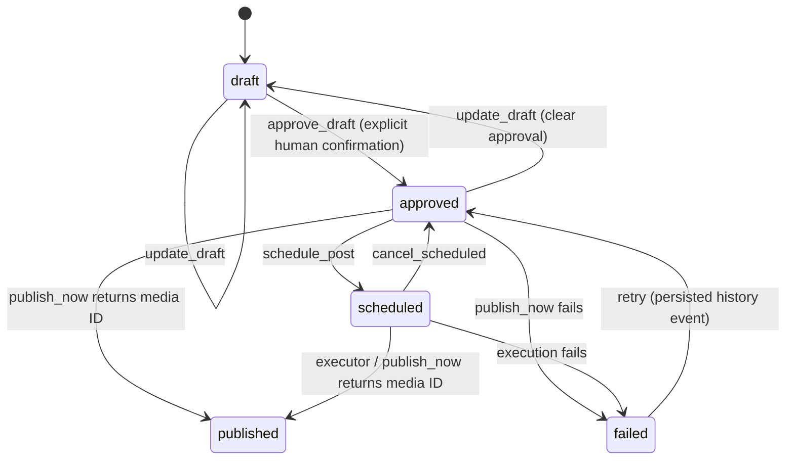

# FinPlayerOS Threads MCP

Our own thin TypeScript MCP server for **@finplayer_ceo**, with explicit human approval before scheduling or publishing. Node 24, strict TypeScript, **FastMCP over stdio**, and Zod. The core is framework-agnostic. Threads uses a deterministic stub; there is no live Meta HTTP code or third-party Threads library.

This is Task 1b. Task 1c still awaits the Meta app with the Threads use case, the @finplayer_ceo tester invitation/acceptance, and OAuth. Hermes profile, approval UI, credentials and Gateway wiring belong to **Hermes Master** and are not configured here.

## Run locally

```sh
npm ci && npm run build && node dist/index.js
```

`npm start` also runs the built server. It waits for an MCP client on stdin. Stdout contains only MCP JSON-RPC; startup errors use sanitized stderr. Framework request logging is disabled to avoid logging credentials or user content. A stub media ID proves only a local simulation.

`.env.example` is a template, not an automatically loaded file. For manual environment-file loading, copy it to `.env` and use `node --env-file=.env dist/index.js`. Leave credential placeholders empty for local scaffold work.

## Hermes wiring (for Hermes Master)

**Hermes Master owns this wiring; it has not been performed here.** No Hermes profile or configuration is read or modified by this work. The stdio command (replace the placeholder with the absolute path of the checkout Hermes Master deploys) is:

```sh
node /absolute/path/to/finplayeros-threads-mcp/dist/index.js
```

Example MCP server entry for Hermes Master:

```yaml
mcp_servers:
  finplayer_threads:
    command: node
    args:
      - /absolute/path/to/finplayeros-threads-mcp/dist/index.js
    env:
      THREADS_APP_ID: ""
      THREADS_APP_SECRET: ""
      THREADS_ACCESS_TOKEN: ""
      THREADS_USER_ID: ""
      BLOB_READ_WRITE_TOKEN: ""
      FINPLAYER_DB_PATH: /absolute/path/to/finplayeros-threads-mcp/data/finplayer.sqlite
      THREADS_STUB_MODE: success
      TZ: Asia/Hong_Kong
```

`/absolute/path/to/finplayeros-threads-mcp` is a placeholder: substitute the real absolute checkout path for both the script and `FINPLAYER_DB_PATH` (run `npm ci && npm run build` there first). Absolute paths are required because the client's working directory may differ from the checkout. The block includes every application environment variable, including the reserved Threads credentials. Setting those credentials does not enable live Meta calls: the entrypoint always selects the stub.

## Environment

| Variable | Default | Purpose |
| --- | --- | --- |
| `THREADS_APP_ID` | empty | Reserved Threads App ID; unused by the stub. |
| `THREADS_APP_SECRET` | empty | Reserved Threads App secret; unused by the stub. |
| `THREADS_ACCESS_TOKEN` | empty | Reserved OAuth token; unused by the stub and refresh stub. |
| `THREADS_USER_ID` | empty | Reserved @finplayer_ceo Threads user ID; unused by the stub. |
| `BLOB_READ_WRITE_TOKEN` | empty | Vercel Blob read/write token. Image upload fails clearly if absent; deletion becomes a no-op. |
| `FINPLAYER_DB_PATH` | `./data/finplayer.sqlite` | SQLite database, relative to the process working directory. |
| `THREADS_STUB_MODE` | `success` | `success` or `fail`; fail throws during container creation. Invalid values reject startup. |
| `TZ` | `Asia/Hong_Kong` | Default process timezone. Offset-free `publish_at` always uses Hong Kong time; use an explicit offset for other timezones. |

Secrets are supplied only through environment variables. They are never invented, logged, or stored in the queue. No provider CLI login or credential discovery is used. Do not add credentials to tracked files.

## State machine and approval



`approve_draft` is the human gate. The caller must invoke it only after the human confirms the exact draft content. The server records who approved it, when, and the state history; it does not supply a human identity system or an approval UI. Caller-supplied approval/state fields are rejected by draft input schemas.

The server exposes exactly seven tools:

| Tool | Signature | Rule |
| --- | --- | --- |
| `create_draft` | `text, link?, image_ref?, source_note?` | Creates a local draft; validates text length. |
| `update_draft` | `id, text?, link?, image_ref?, source_note?` | Draft or approved only. Editing approved resets to draft and clears `approved_at` and `approved_by`. |
| `approve_draft` | `id, approved_by?` | Draft only; records approval time and optional approver. |
| `schedule_post` | `id, publish_at` | Approved, or failed with prior approval; future time required. |
| `publish_now` | `id` | Approved, scheduled, or failed with prior approval. |
| `list_queue` | `state?` | All posts or one of the five states. |
| `cancel_scheduled` | `id` | Scheduled → approved only; clears `publish_at`. |

`link` is an HTTP(S) source link and `source_note` is local inspiration metadata; neither is automatically added to the published text. `image_ref` is a local PNG/JPEG path, uploaded only at publish time. At least one field is required for updates; `null` clears optional metadata. The earlier `image_path` / `image_url` draft fields have been replaced by `image_ref`.

Editing scheduled, published or failed posts is rejected. Invalid edits preserve existing content and approval. Every successful edit to approved content requires reapproval, including edits to metadata. A failed retry first **persists `failed → approved`**, preserving the original approver/time, then schedules or publishes through the normal gate. Its history records that transition. Published posts cannot be republished.

Tool results contain `{ "post": ... }` or `{ "posts": [...] }` in JSON text and structured content. Posts show `state`, creation/update/approval/publication timestamps, applicable `publish_at`, `threads_media_id`, `last_error`, and transition `history`. Unset fields are omitted. Business-rule rejections return `isError: true`; malformed inputs are rejected by FastMCP with a protocol validation error. A publishing failure persists `failed` and returns `isError: true`. Missing or blank media IDs never produce published state.

## SQLite store

`SqliteQueueStore` uses Node 24's built-in `node:sqlite` `DatabaseSync`; no native third-party SQLite dependency is needed. SQLite is the default persistent store; `InMemoryQueueStore` remains available for tests. The earlier JSON store has been removed; no automatic JSON import is supplied for this scaffold.

Each validated post and its history are atomically upserted together, using WAL and full synchronous writes. The database directory is created on demand. Malformed records fail closed. `data/`, SQLite files and their WAL/SHM sidecars, `.env`, `node_modules/`, and `dist/` are gitignored.

Run **one owning service/process per database**. Core mutations are serialized so concurrent requests in that service cannot publish the same post twice. SQLite atomic writes do not make remote publishing exactly-once across separate processes. Gateway jobs should call the owning MCP server or use the in-process executor described below.

## Scheduling and execution

`schedule_post` only stores a normalized UTC `publish_at`. For example, `2026-10-30T09:00:00` means Asia/Hong_Kong and is stored as `2026-10-30T01:00:00.000Z`. Minutes, optional seconds/milliseconds, and `Z` or `±HH:MM` offsets are supported. Past times and invalid calendar dates are rejected.

It never calls Meta, uploads an image, or creates a container ahead of time: containers expire after 24 hours. An external executor must run at the due time. No scheduler starts automatically in the stdio entrypoint.

`src/scheduler/executor.ts` provides `ScheduledExecutor.runDueScheduled(now)`. It selects due posts, then rechecks their state, due time, and approval under the service lock before using the same publish path. It skips canceled/rescheduled posts, handles individual publish failures, and never scans failed posts for automatic retry. `dueScheduled(posts, now)` remains a pure selector. Neither adds an MCP tool. There is no separate executor CLI that might accidentally create a second database owner.

Publication follows **create container → check status → publish container**. Only `FINISHED` permits publishing. `IN_PROGRESS` is checked immediately and then once per minute for at most five minutes. Exceptions, upload failures, expiry, unusable statuses, timeouts, or missing IDs record `failed`. A returned media ID is required as proof; `publish_now` may also publish an approved post immediately or a scheduled post early when explicitly requested.

See [docs/scheduler.md](docs/scheduler.md) for the Hermes Gateway cron design, cancellation considerations, single-owner integration, and the **weekly token-refresh job stub**. `refreshThreadsToken()` documents `GET /refresh_access_token?grant_type=th_refresh_token`, performs no HTTP, and returns `not-configured`. No cron job or token renewal is wired here.

## Text validator

`countThreadsLength(text)` iterates grapheme clusters with `Intl.Segmenter`. A cluster containing an extended pictographic emoji, regional indicator, keycap, or emoji modifier counts as its **UTF-8 byte length**; every other cluster counts as **one**, including Cantonese and combined accented letters. `😀` = 4, `🇭🇰` = 8, `1️⃣` = 7. Creation and editing reject counts above 500 with the actual count in the error.

## Images: Vercel Blob

The owner selected **Vercel Blob**. `VercelBlobImageHost` implements `ImageHostAdapter.upload(localPathOrBuffer, contentType) → { publicUrl, deleteHandle }` and `delete(handle)` using the official `@vercel/blob` SDK's `put` and `del`.

Uploads use `access: 'public'`, `addRandomSuffix: true`, and a crypto-random pathname. Only a public HTTPS URL is passed as the Threads client's `image_url`. Local files are read at publish time; remote image downloads are not implemented. PNG/JPEG paths and buffers are supported by the adapter. Without `BLOB_READ_WRITE_TOKEN`, upload fails before reading a file or creating a Threads container, leaving the post failed rather than published.

After a successful publication, media proof is saved **before** the delete-after-publish hook calls `adapter.delete(deleteHandle)`. Deletion without a token is a no-op. Deletion failure adds `image_cleanup_error` while preserving published state and media proof, so it cannot trigger a duplicate publish retry. Failed publication retains the upload; retention/reconciliation of those orphaned uploads belongs to live integration work. Raw provider exception details are not exposed or logged.

The SDK is pinned to **2.4.0**: it supplies the required token-based `put`/`del` APIs without the vulnerable pinned transitive Zod dependency introduced through the newer SDK's CLI/OIDC dependencies. This scaffold does not use OIDC or CLI credential discovery. Adapter tests mock `@vercel/blob` with `vi.mock`; no Blob network requests are made by tests or verification. The configured adapter can upload to Blob when an owner supplies a real token; Meta remains stubbed independently.

## Framework and client status

FastMCP 4 handles tool registration, Zod parameter schemas, stdio, and the SDK's in-memory test transport cleanly on Node 24. The official `@modelcontextprotocol/sdk` remains a direct dependency for MCP test clients/transports; core rules depend on neither framework.

`ThreadsClient` defines `createContainer`, `getContainerStatus`, `publishContainer`, and optional `getPublishingLimit`. `StubThreadsClient` is deterministic, with constructor-configurable failures/status sequences and `setMode` for tests. `THREADS_STUB_MODE` selects startup success/failure; fake proof IDs begin with `stub-media-`.

`RealThreadsClient` still contains no HTTP and throws **“not configured — awaiting Meta app + OAuth (Task 1c)”**. Live account verification, OAuth, token renewal/persistence, quotas, and ambiguous-result/crash reconciliation remain pending. Neither container creation nor successful image upload proves publication.

## Development and CI

```sh
npm ci && npm run lint && npm run typecheck && npm test && npm run build
```

`lint` runs flat-config ESLint with typescript-eslint plus `tsc --noEmit`; `typecheck` runs `tsc --noEmit` separately. Vitest covers the gate and state machine, emoji lengths, SQLite persistence, mocked Blob uploads/cleanup, due execution, the refresh stub, runtime composition, and an in-memory MCP connection exposing exactly seven tools. Temporary files stay under the repo's gitignored `.test-data/`. CI runs these checks on pull requests and pushes to main using Node 24.

- `src/core/`: framework-agnostic rules, history, text/time validators, pure due selector.
- `src/stores/`: queue interface, SQLite and in-memory stores.
- `src/images/`: Blob adapter, interface, unconfigured fallback for isolated core tests.
- `src/clients/`: Threads interface, stub, throwing real-client placeholder.
- `src/scheduler/`: due executor and token-refresh stub; [integration design](docs/scheduler.md).
- `src/runtime.ts`, `src/server.ts`, `src/index.ts`: provider composition, thin FastMCP tools, stdio startup.

## Out of scope

Live Meta/OAuth and token renewal; actual Hermes profile/Gateway cron wiring; Buy Me a Coffee (BMC); publishing without human approval; replies/DMs; analytics; other platforms; automatic screenshot/link ingestion and voice generation; a standalone desktop app.

Sources: the supplied FinPlayerOS design and Threads path spike, followed by the owner's updates and `finplayer-mcp-stub.md` handoff. Owner updates take precedence over the earlier approved-edit and image-host placeholders. Framework/API references: [FastMCP](https://github.com/punkpeye/fastmcp), [Vercel Blob SDK](https://vercel.com/docs/vercel-blob/using-blob-sdk).
